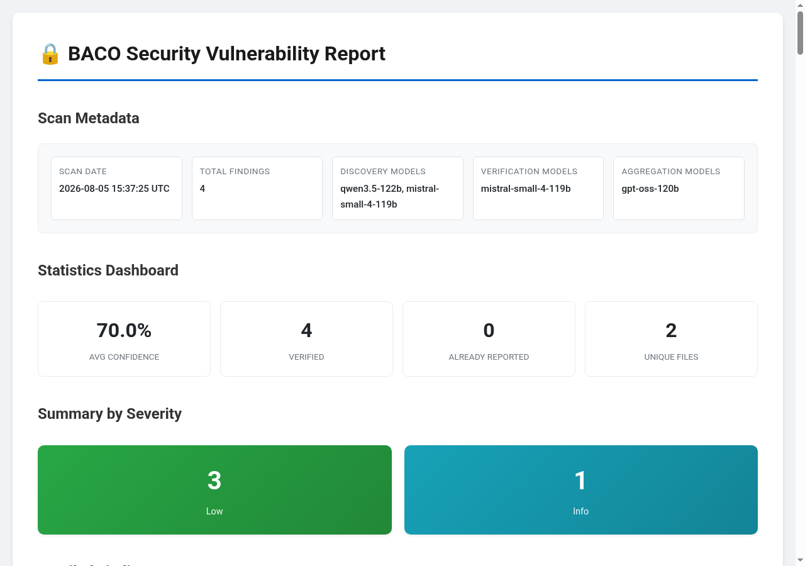

# BACO — Bug Analysis & Cross-reference Orchestrator

Find real vulnerabilities. Suppress false positives. Ship fixes with evidence.

BACO is a SAST scanner that combines semgrep pattern matching, LLM-powered
verification, and cross-file analysis to surface vulnerabilities that matter —
and filter out the noise that buries them. It runs 23 analysis phases
(4 parallel, 19 sequential), checkpoints after each, and produces
machine-readable and human-readable reports.

Grounded in 19 research integrations from the
[Awesome-LLMs-for-Vulnerability-Detection](https://github.com/huhusmang/Awesome-LLMs-for-Vulnerability-Detection) survey.

[](https://github.com/CodeAtCode/baco-scanner/actions/workflows/ci.yml)
[](https://app.codecov.io/gh/CodeAtCode/baco-scanner)
[](https://www.gnu.org/licenses/gpl-3.0)
[](https://www.rust-lang.org)

[](example-report.html)

---

## Prerequisites

- **Rust** 1.85+ (`rustup`)
- **An LLM API key** — Mistral, OpenAI, or any OpenAI-compatible endpoint.
  Anthropic keys are **not** supported; only OpenAI-compatible APIs work.
- **Semgrep** on PATH (`pip install semgrep` or [see install options](https://semgrep.dev/docs/getting-started/))

## Quick Start

```bash
# 1. Build from source
git clone https://github.com/CodeAtCode/baco-scanner.git
cd baco-scanner
cargo build --release

# 2. Install semgrep
pip install semgrep

# 3. Set your LLM API key
export LLM_DISCOVERY_KEY="your-key-here"  # or LLM_API_KEY for generic fallback

# 4. Initialize config and run pre-flight checks
./target/release/baco init /path/to/project
./target/release/baco doctor

# 5. Scan
./target/release/baco scan --config /path/to/project/baco.toml

# 6. Read the results
#    baco-output/findings.json  — machine-readable (all fields)
#    baco-output/report.html    — interactive browser report
```

> **Cost note:** Each scan makes multiple LLM API calls per finding.
> Run `baco scan --dry-run` first to estimate token usage and cost.

See [CLI Reference](docs/cli-reference.md) for all subcommands:
`baco report`, `baco verify`, `baco resume`, `baco preset`.

## What It Does

BACO runs a phased pipeline that progressively refines findings:

1. **Find** — semgrep + taint rules + AST anchoring across 10 languages
2. **Verify** — LLM verification with a skeptical self-refutation gate
3. **Connect** — cross-file analysis + ticket cross-referencing
4. **Score** — confidence calibration with citation verification
5. **Report** — JSON, HTML, SARIF, Markdown outputs

Optional phases add CWE-aware MoE routing, rule synthesis, exploit
synthesis, threat modeling, auto-patching, and PoC compilation.
See [Architecture](docs/architecture.md) for the full phase graph and
[Configuration](docs/configuration.md) for enabling flags.

## Supported Languages

C/C++, Rust, Python, JavaScript, TypeScript, PHP, Go, Java, C#, Ruby —
all with static analysis (tree-sitter + semgrep) and LLM verification.
See [Supported Languages](docs/languages.md) for the full matrix.

## Outputs

- `findings.json` — complete vulnerability data (machine-readable)
- `report.html` — interactive report with severity filtering and code highlighting
- `report.sarif` — SARIF 2.1 for CI/CD integration (GitHub Code Scanning, Azure DevOps)
- `findings.md` — Markdown summary of findings

## Evidence & Verification

- **Citation verification**: deterministic file existence + line range checks in the Reporting phase; failures halve confidence and add a note
- **Prior-findings skip lists** (`[prior_runs]`): confirmed/FP findings from prior scans injected into discovery prompts to reduce redundancy
- **Rejected-findings persistence** (`include_rejected = true`): persists "rejected" array in JSON and "Investigated & Dismissed" appendix in HTML
- **Org-context calibration** (`[org_context]`): organizational policy profile injected into prompts to reduce false positives
- **Eval oracles**: known-answer harness under `eval/` with precision/recall/F1 scoring via `baco eval`

## Research Foundation

BACO integrates 19 research techniques from the
[Awesome-LLMs-for-Vulnerability-Detection](https://github.com/huhusmang/Awesome-LLMs-for-Vulnerability-Detection)
survey. Integrations span agentic workflows, context enhancement, rule
synthesis, MoE routing, and confidence calibration.

See [Research Integration](docs/research-integration.md) for per-paper details
and [Paper Survey](docs/llm-vuln-detection-papers-survey.md) for the full 36-paper survey.

## Documentation

- [Architecture](docs/architecture.md) — PhaseGraph pipeline, all phases, data flow
- [Configuration](docs/configuration.md) — all config options, LLM setup, phase flags
- [CLI Reference](docs/cli-reference.md) — all subcommands and options
- [Supported Languages](docs/languages.md) — language coverage matrix
- [Research Integration](docs/research-integration.md) — 19 integrated papers with techniques and results
- [Paper Survey](docs/llm-vuln-detection-papers-survey.md) — full 36-paper survey
- [Operator Tuning](docs/operator-tuning.md) — performance flags and scenario-based tuning
- [Output Interpretation](docs/output-interpretation.md) — reading findings, confidence, triage verdicts
- [Troubleshooting](docs/troubleshooting.md) — common errors and fixes
- [CI Integration](docs/ci-integration.md) — continuous integration setup

### Reading Order

1. **README.md** (this page) — overview, quick start
2. **docs/configuration.md** — set up your config
3. **docs/architecture.md** — understand the pipeline
4. **docs/output-interpretation.md** — read your results
5. **docs/operator-tuning.md** — tune for your scenario

## Acknowledgements

Sponsored and tested with [Regolo.AI](https://regolo.ai/) — LLM API services.
